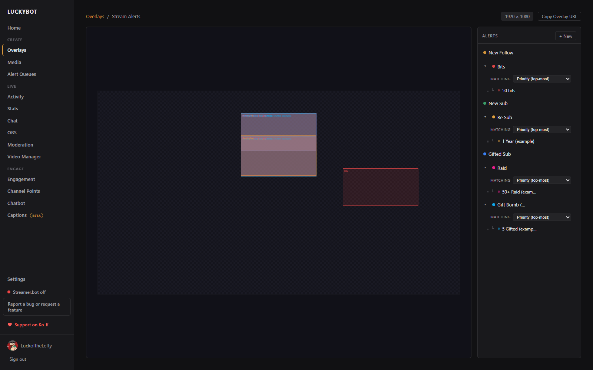
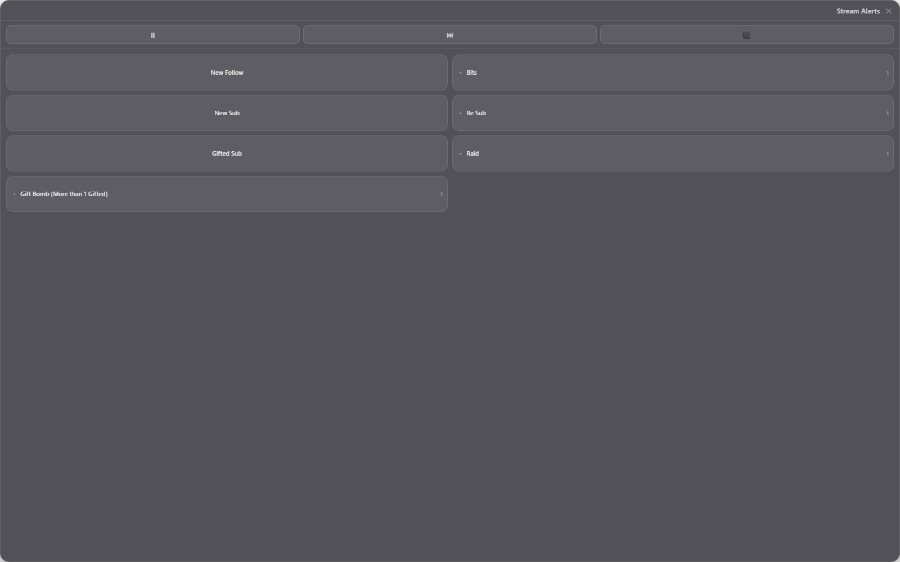

# Alerts and Variants

---

## Alerts

An alert is a canvas animation that plays when a specific event fires. Each overlay can have multiple alerts.

<!-- shot: alerts-list.png | /overlays/<id> (a basic overlay with several alerts and a variant) | the overlay page: preview on the left, alert rows with their When and Do chips on the right, Copy Overlay URL and Tour in the header -->

Clicking an overlay card opens this page: a preview of every alert's layers on the left, and the alert list on the right. Static overlays list canvases here instead, and widget overlays list widget canvases. The header has **Copy Overlay URL** for OBS and a **Tour** button that walks through the page and ends on adding the overlay to OBS.

Each alert row reads like the rest of the app. **When** lists the events that set it off. **Do** says what it does: how long it shows (or "Show until the sound ends"), the sound it plays, "Read aloud" when text-to-speech is on, and the chat message it posts.

### Creating an alert

Click **+ New**, type a name, and press Enter. The alert editor opens.

The strip across the top of the editor sums up the alert as **When**, **Only if**, and **Do**: its events, any event conditions (or, for a variant, its condition), and what it shows, plays, reads aloud, and posts, plus how it joins the queue and which alert it chains to. Click a chip to open the setting that changes it.

<!-- shot: alert-editor-strip.png | /overlays/<id>/alerts/<alertId> | the alert editor with the When / Only if / Do strip under the top bar -->

**Alert Settings** opens a pop-up with four tabs:

- **Events**: which events trigger the alert, plus filters and queue behavior.
- **Duration**: how long the alert holds on screen, in milliseconds. 0 holds it until the alert's sound finishes. With variants, **Apply to all variations** copies this duration to every variant.
- **Chat message**: an optional line posted to chat when the alert fires, with `{{username}}` and other variables. It posts once per alert, even when several copies of the overlay are open. A variant's message replaces the alert's when that variant plays.
- **TTS**: optional text-to-speech for this alert.

Then build the alert on the canvas. See [Visual Editor](visual-editor.md). The editor's **Tour** button walks through it.

### Choosing events

Click **Choose events** in the Events tab to open the event picker. It has three tabs: **Native** (events LuckyBot gets itself from your Twitch login, plus TikTok and TreatStream when connected), **Streamer.bot**, and **Cloud** (locked until LuckyBot Cloud is connected). An alert can respond to any number of event types.

YouTube Gifts bought with Jewels arrive through Streamer.bot as **YouTube > JewelsGifted**, with the gift's name, image, and Jewel count as variables.

Extra filters appear for certain events:

- **Command filter**: for chat command events, only fire for a specific command.
- **Reward filter**: for channel point events, only fire for specific rewards.
- **Only fire when**: a condition that gates the whole alert, using the same condition builder as variants. For example, a Bits alert that only fires at 100 bits or more.

### Sub upgrades

When a viewer continues a gifted sub, upgrades from Prime to a paid sub, or pays a gift forward, Twitch sends its own event type for it. If the overlay has an alert for that exact type, that alert plays. If it does not:

- **GiftPaidUpgrade** and **PrimePaidUpgrade** play your **Sub** alert (or your **ReSub** alert if there is no Sub alert).
- **PayItForward** plays your **GiftSub** alert (or **Sub**).

The event data carries `isPaidUpgrade` and `upgradeType`, so a variant condition can tell an upgrade from a plain sub.

### Queue behavior

When the overlay is assigned to a blocking queue, each alert picks how it joins:

- **Queue**: waits its turn.
- **Skip Queue**: plays immediately alongside whatever else is playing.
- **Skip if Busy**: plays only if nothing else is playing, otherwise it is dropped.
- **Replace Same**: replaces a queued alert of the same type instead of stacking up.

### Chaining

**Chain to Alert** plays another alert automatically when this one finishes. Use it for multi-part sequences.

### Enabling, chance, renaming, deleting

- Each alert has an enable toggle in the list. Disabled alerts never play.
- Each alert has a chance percentage. When multiple alerts are bound to the same event, LuckyBot picks one based on these weights.
- Rename with the pencil icon, or right-click an alert row for rename, add variant, and delete options.
- Deleting an alert or a variant opens a pop-up that names it and asks "Are you sure you want to delete it?". An alert's variants go with it. After you confirm, **Undo** in the notification brings it back for a few seconds.

---

## Variants

Variants play a different version of an alert based on conditions: a special animation for Tier 3 subs, a bigger alert for raids over 100 viewers, and so on.

Each variant has its own canvas layout, duration, and condition rules. The parent alert is the default when no variant matches.

### Creating a variant

Right-click an alert row and choose **+ New Variant**, or use **Duplicate & Edit** on an existing variant to copy its canvas and conditions.

### Variant conditions

Click **Variant Setup** in the top bar of the variant editor.

- **Simple view**: one condition per row, all joined with AND. Quick-condition chips cover common cases like sub tiers.
- **Advanced view**: condition groups with AND and OR logic, nestable, with a Wrap Selected action for grouping existing rules.

A condition has a field name, an operator (`==`, `!=`, `>`, `>=`, `<`, `<=`), and a value. A variables panel lists known fields from live events; the [Activity Feed](activity-feed.md) shows the full payload of any real event.

A variant with no conditions matches every event of the parent type.

**Also fire this variant on**, at the bottom of Variant Setup, reuses the variant's canvas for other events, each with its own optional condition. For example, one "big supporter" canvas for Bits 500 or more, a tip of 5 or more, or a gift sub.

### Match mode

When an alert has variants, the **Matching** dropdown on the alert row picks how ties are resolved:

- **Priority (top-most)**: the first matching variant in list order wins. Drag variants to reorder.
- **Random among matches**: picks randomly from all matching variants.

Variants also have their own chance percentage, and can be enabled or disabled individually from their right-click menu.

---

## Testing

The editor's **Test** button plays the alert with sample data in the preview. Its arrow menu offers **Test with custom data**, where you edit the event payload first, and **Also fire on live overlays**, which sends the test to every connected browser source including OBS.

To see how a real event plays, **Replay** it from the [Activity Feed](activity-feed.md). A replay goes through event matching and queues exactly like the original.

---

## How alerts play in OBS

A few things happen behind the scenes so the first alert of a stream plays like the tenth:

- When the overlay loads, it fetches every alert sound and video (variants and random media pools included) and refreshes them every 20 minutes.
- An alert waits for its media to be ready before its animation and hold time start. The wait is short and **Skip** in the queue cancels it.
- If a sound or video stops getting data partway through, it asks for the rest from where it stopped.
- A sound still playing when its alert's visuals end finishes off screen (up to 30 seconds) without holding up the next alert.

After updating LuckyBot, refresh your alert browser sources in OBS so they load the latest version.

---

## The Deck

**Popout Deck** in the alert list header (desktop app) opens a small always-on-top window with one button per alert. Click a button to fire that alert with the last real event's data for its type, for example to replay a follow alert on demand. Alerts with variants open a folder view with the base alert and each variant.

The bar at the top pauses, skips, or clears the overlay's queue. Right-click an alert for **Replay (Edit)**, which opens the custom-data test, or to enable and disable it. Right-click empty space to set the window's transparency. The window remembers its position per overlay.

---

## Text-to-speech

Each alert and variant configures TTS independently, in the **TTS** tab of Alert Settings:

- Enable TTS for this alert.
- **Message**: a template with insertable `{{variable}}` chips (for example `{{user}} just followed!`).
- **Volume** (0 to 100).
- **Timing**: wait for the alert's sound and video to finish (the default), or a fixed delay only, which lets TTS talk over the media. Either way you can add a delay in milliseconds.
- **Minimum amount**: only read aloud when the amount (bits, tip, raid viewers, gifted subs) is at least this. It applies to the alert and all its variants unless a variant overrides it. 0 reads every one; the alert itself still shows either way.
- **Voice override**, if you want a different voice than the default.

The provider and default voice are configured in **Settings > Audio**. See [Settings](settings.md).
