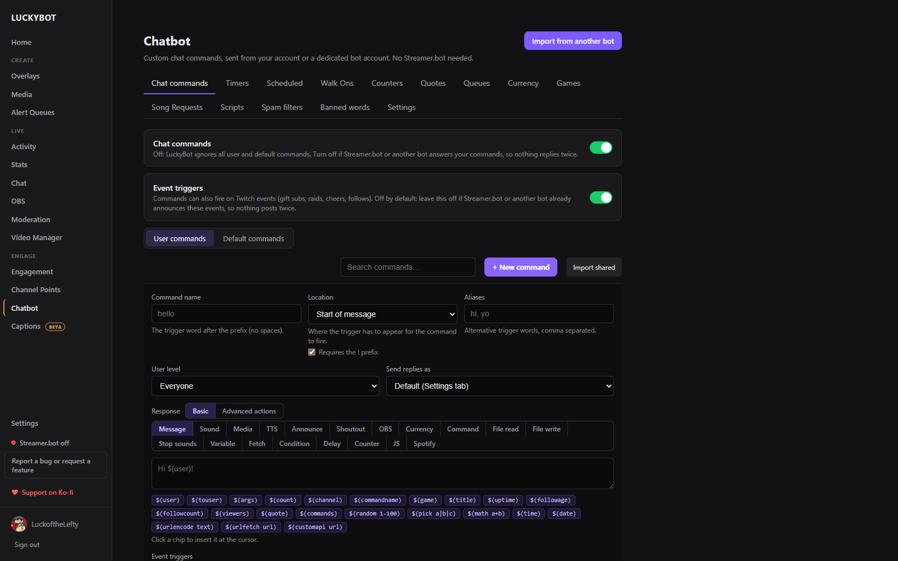

# Commands

How to build a chat command in LuckyBot: the Blueprint editor and the form, the fields every command has, every variable available in a response, and the full list of steps.

<!-- shot: chatbot-new-command.png | /chatbot | + New command, Blueprint view: When node wired to two or three steps, the side panel showing a selected step -->

---

## Creating a command

Go to **Chatbot > Chat commands > User commands** and click **+ New command**. The editor opens in a pop-up, as a [Blueprint](#blueprint) by default. **Advanced (form)** at the top switches to the form, where the same settings sit in three sections: **When** (what starts the command), **Only if** (who can use it and when), and **Do** (what it does). In the Blueprint, When and Only if are edited by clicking the When box.

Every command has:

- **Name** - the trigger word, typed after your prefix (`!` by default). No spaces.
- **Location** - where the trigger has to appear: at the start of the message (the default), the whole message exactly, anywhere in the message, or a regular expression. **Requires the ! prefix** can be turned off for phrase triggers.
- **Aliases** - extra trigger words that run the same command.
- **User level** - the minimum permission to use it: Everyone, Subscriber, VIP, Moderator, or Broadcaster.
- **User cooldown** and **global cooldown**, in seconds. User cooldown limits one viewer; global cooldown limits everyone combined.
- **Stream state** - fire when you are online, offline, or both.
- **Send replies as** - use the account chosen in Settings, or override it per command (your account or the bot account).
- **Cost** - currency charged to run it, when Currency is on.
- **Group** - an optional group name that organizes the command list. Type a new name to create a group.
- **What it does** - steps in the Blueprint, or in the form a Basic or Advanced actions response, described below.

**Save** works with no name filled in: LuckyBot asks for the name, then saves. **Test** runs the draft right away without saving it: chat replies post to your chat for real and sounds, media, and TTS play on your overlays, while points, counters, and toggles are left alone.

### Event triggers

A command can also fire on events (gift subs, raids, cheers, follows, channel point redemptions, thon grants, and any other event overlay alerts can fire on), alongside its typed trigger or in place of it. At the top of When, pick **Typed in chat** or **Events only**; an Events only command has a name for your lists and nothing to type. Click **+ Choose events** to add events. Each event takes an amount range ("at least" and "to"), for example only cheers of 100 bits or more; leave "to" empty for no cap, or set both the same for an exact amount. A command with an exact amount wins over range commands for the same event. A channel point trigger can be narrowed to one reward. The chips beside each event insert the event's own values, such as `$(gifts)` on a gift bomb.

Twitch events work on their own. Other sources (YouTube, Kick, donations) need Streamer.bot connected; YouTube Gifts count their amount in Jewels. Event triggers also need the **Event triggers** switch at the top of the Chat commands tab, which is off by default.

Channel point redemptions ignore the command's cooldowns, because the viewer's points are spent the moment they redeem. Set cooldowns and per-viewer limits on the reward itself in Twitch.

---

## Blueprint

<!-- shot: chatbot-blueprint.png | /chatbot | + New command, Blueprint with a Branch step: When wired to Branch (if / else), True and False paths each wired to a Send message, a colored $(user) wire visible -->

The Blueprint shows a command as boxes joined by wires, running left to right:

- **When** is the first box. It shows what starts the command and its Only if conditions. Click it to edit them in the panel on the right.
- **Steps** are the boxes after it. Click a step to edit it in the panel on the right. Right-click a step for **Duplicate**, **Turn off** (or **Turn on**), and **Delete**.
- **White wires** set the order steps run in. Drag from the pin on the right of a step to the next step to wire it.
- **Colored wires** show where a value such as `$(user)` comes from: When, or an earlier step that sets it.

To add a step, click **+ Add step**, or right-click the empty canvas, or drag a white wire out to an empty spot. The step menu is searchable and grouped by kind. A step that is not wired to When will not run or be saved; the editor warns about it.

The toolbar has **Undo** (Ctrl+Z) and **Redo** (Ctrl+Y), **Tidy up** to lay the steps out left to right again, and **Fit** to bring everything into view. Nothing is saved until you press Save.

### Branch and Split

Two Flow steps send a command down more than one path:

- **Branch (if / else)** compares two values, like a Condition. Steps wired from **True** run when it matches, steps wired from **False** when it does not. Wire both paths into the same step to carry on after the branch.
- **Split (at the same time)** runs 2, 3, or 4 paths at once. Wire the paths into the same step to carry on once all of them finish. A long Delay in one path does not hold up the others. A **Stop here** inside a path ends only that path, unless it is set to end the whole command. If two paths set the same value, the editor warns that it ends up holding whichever path finished last.

In the form, Branch shows its True and False step lists inside it, and Split shows a step list per path.

### Using values

Every value When hands over is listed on the When box as a colored pin, dimmed until a step uses it. Steps that set a value (Fetch URL, Set variable, Read from file, and so on) get a pin for it too.

- **Drag a value's pin onto a step** to use it there. The wire appears and the value is written into the step's field. One value can feed as many steps as you like.
- A step with more than one field asks which one the value goes in.
- While you drag, steps that cannot take the value are dimmed: steps with no text field, and steps that run before the value is set.
- To remove a wire, click it and press Delete, or right-click it. Ctrl+Z brings it back.

Every text field also has a **+ value** button, and typing `$(` in a field opens the same picker. It lists the values from When, from the steps before this one, and other values looked up when the command runs, with a search box. This works in the Blueprint and the form alike.

### Tour

The first time the Blueprint opens, a short tour offers to walk through it. The **Tour** button on the Blueprint's toolbar plays it again.

Timers (Action steps) and walk ons use the same Blueprint, starting from a **Timer fires** or **Viewer walks on** box. Their schedule and who they are for stay as fields above it.

---

## Response modes in the form

In **Advanced (form)**, the Do section has two response modes.

### Basic

One action. Pick its type from the row of chips:

- **Message** - a text reply. Type it directly, or build it from `$(...)` variables (see below). Multiple messages can be added; one is picked at random or in order each time the command runs.
- **Sound** - plays a sound through a Sound Alerts overlay. Pick a file from the media library or paste a URL, set the volume, trim the start and end on a waveform, and choose which Sound Alerts overlay plays it (or any of them).
- **Media**, **TTS**, **Announce**, **Shoutout**, **OBS**, **Currency**, **Command**, **File read**, **File write**, **Stop sounds**, **Variable**, **Fetch**, **Condition**, **Delay**, **Counter**, **JS**, **Spotify**, **Home Assistant** - the same single action as the matching step below, without building a list.

### Advanced actions

A step list. Steps run top to bottom, in order, and each one can read variables set by an earlier step. Add as many as you like. The step picker is searchable and grouped: Chat, Sound and media, Apps and devices, Viewers and currency, Flow, and Data and code. Branch, Split, and Repeat group hold their own step lists inside them.

---

## Variables

Any message or text field in a step can use these. Press **+ value** beside a field, or type `$(` in it, to pick from a searchable list.

| Variable | Resolves to |
|---|---|
| `$(user)` | The viewer who ran the command |
| `$(touser)` | The first typed argument (with a leading `@` stripped), or `$(user)` if there is none. The usual "target" for a command like `!hug` |
| `$(args)` | Everything typed after the command, as one string |
| `$(1)`, `$(2)`, `$(3)`... | Individual typed arguments by position (`$(1)` is the first word after the command) |
| `$(count)` | The command's own counter value, if it has one |
| `$(channel)` | Your channel name |
| `$(commandname)` | The name of the command that is running |
| `$(game)` | The current stream category |
| `$(title)` | The current stream title |
| `$(uptime)` | How long the stream has been live |
| `$(followage)` | How long `$(touser)` has followed |
| `$(followcount)` | Your total follower count |
| `$(viewers)` | Current viewer count |
| `$(quote)` | A random quote from the Quotes list |
| `$(commands)` | A list of your available commands |
| `$(random 1-100)` | A random whole number in the given range |
| `$(pick a\|b\|c)` | A random choice from a `\|`-separated list |
| `$(math 1+2*3)` | Evaluates a simple arithmetic expression |
| `$(time)` | The current time |
| `$(date)` | The current date |
| `$(urlencode text)` | URL-encodes the given text |
| `$(urlfetch url)` | Fetches a URL and drops its raw response inline |
| `$(customapi url)` | Fetches a URL and lets you reference specific parts of a JSON response |

An unrecognized `$(...)` is left in the response untouched rather than removed, which usually means the name is misspelled.

---

## Step reference

These steps are the same in the Blueprint and in Advanced actions. Each step's own fields can also use `$(...)` variables, including ones set by earlier steps in the same run.

| Step | What it does |
|---|---|
| **Send message** | Posts a chat message. Add more than one and one is picked at random or in order. |
| **Set variable** | Stores a value under a name, usable later as `$(name)`. |
| **Fetch URL** | Calls a URL, optionally pulls one value out with a JSON path (`data.0.name`), and stores it in a variable. |
| **Condition** | Compares a left value against a right value (`==`, `!=`, `>`, `<`, `>=`, `<=`, contains, starts with, ends with, matches regex, is empty, is not empty). On failure, either stops the command or skips a chosen number of the following steps. |
| **Branch (if / else)** | Compares two values the same way as Condition, then runs the True path when it matches and the False path when it does not. See [Branch and Split](#branch-and-split). |
| **Split (at the same time)** | Runs 2 to 4 paths at once. The step after the Split waits for every path to finish. |
| **Home Assistant** | Turns a device on or off, toggles it, runs a scene or script, presses a button, or calls a service (advanced). See [Home Assistant step](#home-assistant-step). |
| **Play sound** | Plays a sound through a Sound Alerts overlay, same options as the Sound response type. |
| **Show media** | Shows an image or video on a Sound Alerts overlay: position, duration, width, volume, and an optional weighted pool of extra files to pick from randomly. |
| **Speak (TTS)** | Speaks text aloud through a Sound Alerts overlay, with its own volume. |
| **Announcement** | Sends a Twitch announcement (highlighted in chat) in a chosen color. |
| **Skip steps** | Unconditionally skips a fixed number of the following steps. |
| **Stop here** | Ends the command; nothing after this step runs. Inside a Split it ends only its own path, unless **Inside a Split, end the whole command** is ticked. |
| **Confetti** | Fires a confetti burst on a Sound Alerts overlay for a chosen number of seconds. |
| **Enable/disable command** | Turns another command on, off, or toggles it. |
| **Enable/disable timer** | Turns a timer on, off, or toggles it. |
| **Reset timer countdown** | Restarts a timer's interval from now, without changing its enabled state. |
| **Run custom script** | Runs one of your uploaded Python scripts (see [Chatbot: Scripts](chat-bot.md#scripts)). Arguments and the trigger context are passed in; whatever the script prints is stored in a variable. |
| **Viewer queue** | Opens, closes, toggles, clears, or advances a viewer queue, or joins the triggering viewer to one. See [Chatbot: Queues](chat-bot.md#queues). |
| **Spotify** | Play, pause, skip to the next or previous track, queue a fixed track by link, or turn `$(args)` into a song request. A song request sets `$(track)`, `$(artist)`, and `$(trackUri)` on success for later steps. Requires Spotify to be connected under Settings > Connections. |
| **Shoutout** | Runs a Twitch shoutout for a channel name (or `$(touser)`). |
| **Run JavaScript** | Runs a short script with `user`, `args`, `argString`, `channel`, `count`, and `vars` available. Whatever it returns is stored in a variable. |
| **Delay** | Waits before continuing: milliseconds, a duration in seconds/minutes/hours/days, or until a fixed date and time. Waits of 60 seconds or more are saved server-side and survive an app restart; they show up under the Scheduled tab until they run. |
| **Change counter** | Adds, subtracts, or sets a counter's value. |
| **Give currency** | Gives, sets, transfers a whole balance into another currency, or clears every balance in a currency. |
| **Run command** | Runs another command using this run's user and arguments. |
| **Stop sounds** | Stops whatever is playing and clears the queue on a Sound Alerts overlay. |
| **Read from file** | Reads a random line, a specific line, the whole file, or checks whether a file exists, storing the result in a variable. |
| **Write to file** | Appends a line to a file, or overwrites it, with text that can use `$(...)` variables. |
| **OBS control** | Shows/hides a source, switches a scene, turns a filter on or off, or mutes an input. A shown source can automatically revert after a chosen number of seconds. |
| **Lumia Stream** | Triggers a Lumia command, sets a light color (a hex value, a color name, or `$(userInput)` such as "red 40"), fires a Lumia alert, or returns Lumia to its default state. A color can play once, hold as a state for N minutes, or run as a temporary cycle. Requires Lumia Stream under Settings > Connections. |
| **Press key** | Sends a keystroke to the focused window: press, hold for a moment, key down, key up, toggle, or block a key temporarily. Made for hotkey-only apps such as a ReShade toggle; the app must be focused. |
| **Repeat group** | Runs a nested list of steps for a number of seconds or a number of cycles, with a pause between cycles. Pair it with Press key to tap a key repeatedly. |

---

## Home Assistant step

Connect Home Assistant under **Settings > Connections** first. Then the step lists your real devices by name.

Pick what to do (**Turn on**, **Turn off**, **Toggle**, **Run a scene**, **Run a script**, **Press a button**, or **Call a service (advanced)**), then the device. The device list only offers devices that fit the action, and **Refresh devices** loads it again from Home Assistant.

- **Turn on** for a light also takes a **Color** (a name like `red`, a hex value like `#ff8800`, or a color temperature like `3000k`) and a **Brightness %**. Both can be values, so `!lights red` can pass the color in as `$(1)`.
- Turn on, Turn off, and Toggle can **put it back the way it was after** a number of seconds (up to an hour; 0 leaves it).
- **Call a service** takes a service name such as `light.turn_on`, an optional device, and service data as JSON.

### What viewers can control

When the device itself comes from what a viewer types (for example the device field is `$(1)`), the viewer is choosing the device. LuckyBot only lets that through for devices marked **Viewers can control** on the Home Assistant page. Locks, alarms, garage doors and other covers, cameras, valves, and sirens can never be chosen that way. A **Call a service** step cannot take its device or target from a value at all; pick the device directly.

A step with a fixed device runs it whoever typed the command, so use the command's user level to decide who can use it.

---

## Examples

**A simple counter command.** Response type Message: `Deaths this stream: $(count)`, bound to a counter's view command.

**A greeting with a random line.** Response type Message with several message options added, one picked at random each time, for example `Welcome, $(touser)!` and `Hey there, $(touser).`.

**A gamble command.** Advanced actions: Condition checking `$(args)` is not empty (else stop with "Usage: !gamble <amount>"), Give currency to subtract the bet, a Condition on `$(random 1-100)` to decide win or lose, then a Send message reporting the result and a Give currency step paying out on a win.

**A coin flip with Branch.** In the Blueprint: When (`!flip`) wired to a Branch checking `$(random 1-2)` == `1`. From True, a Send message "Heads, $(user)!"; from False, a Send message "Tails, $(user)!".

**Room lights from chat.** When (`!lights`), Only if Subscriber, then a Home Assistant step: Turn on `light.desk_lamp` with Color `$(1)` and put it back after 30 seconds. A viewer types `!lights purple`.

**A lookup command that calls an API.** Advanced actions: Fetch URL with a JSON path pulling one field into a variable, then Send message using `$(that_variable)` in the reply.
