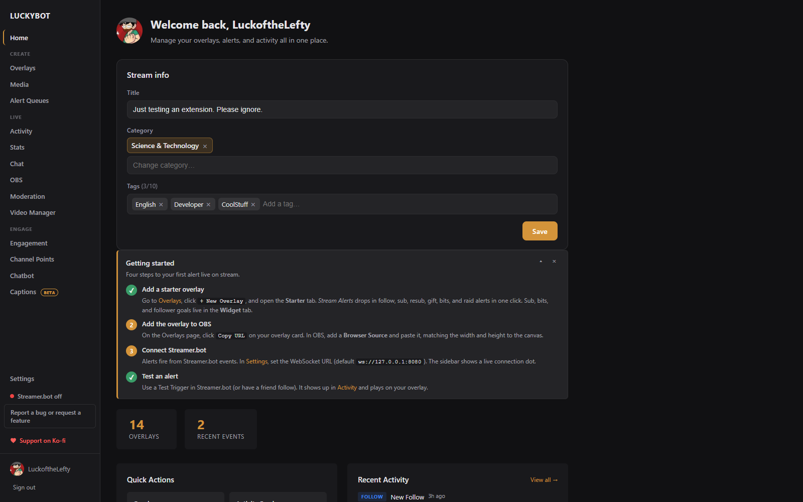
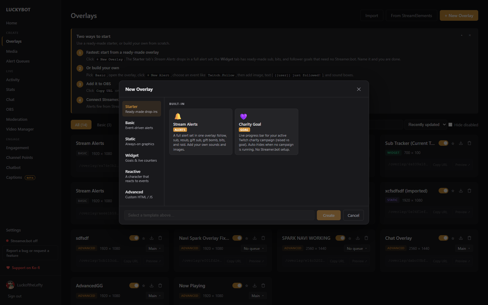
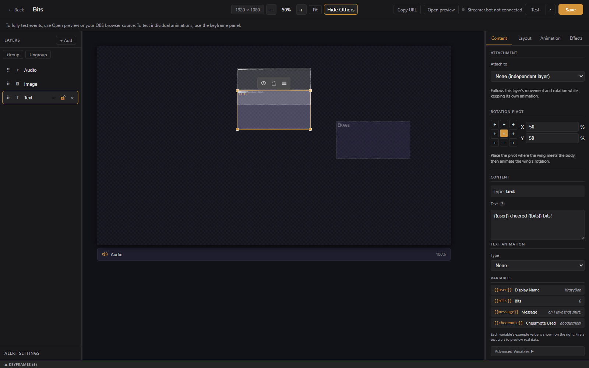

# Getting Started

## What you need

- Windows 10 or later (64-bit)
- OBS Studio or any software that supports browser sources
- A Twitch account

That is everything. LuckyBot connects to Twitch directly with your login, so events, chat, and channel actions work with no other software. Streamer.bot and LuckyBot Cloud are optional add-ons covered in Step 5.

---

## Install

Download the latest installer from the [Releases](https://github.com/luckofthelefty/LuckyBotReleases/releases) page and run it. LuckyBot is added to your Start menu and desktop, and updates itself when new versions come out, taking a database backup first.

---

## First launch

Open LuckyBot. A local server starts on port 58315 and an embedded database initializes automatically. There is nothing else to install or configure.

Click **Sign in with Twitch**. The app shows a code and a link. Open the link in your browser, enter the code, and approve the login. The dashboard opens on the Home page.

On a new install, a **Thanks for installing LuckyBot!** window comes up once, before the usage data notice. It names who to ask on Discord (luckofthelefty) and links to this wiki. Click **Get started** to close it, or **Open the Wiki**.

<!-- shot: home.png | /home | Home with the connection status strip, Stream info, Running now, Recent Activity and Your Overlays visible -->

Home shows, from the top:

- A **connection status strip**: Twitch, OBS, Cloud, and Streamer.bot, plus Home Assistant once you have set it up. Each chip says whether that connection is working. Click one to open Settings.
- **Stream info**: edit your title, category, and tags.
- A **Getting started** card with the four steps below. It ticks off each step as you finish it.
- **Running now**: a running or paused thon with its time left, how many timers are on, and how many overlays are on and open in OBS. Click a row to open the page that controls it.
- **Recent Activity** and **Your Overlays**.

---

## Finding your way around

The sidebar groups the pages:

- **Home**
- **Create**: Overlays, Media, Alert Queues
- **Live**: Activity, Stats, Chat, OBS, Home Assistant, Moderation, Video Manager
- **Engage**: Engagement, Channel Points, Chatbot, Captions
- **Settings**

Below the pages are the Streamer.bot status pill, **Report a bug or request a feature**, and **Support on Ko-fi**.

The dashboard's colors follow the theme you pick under **Settings > Appearance**, on every page.

### Guided tours

A spotlight with a short card points at each part of a page in turn:

- **New Overlay**: with no overlays yet, the picker shows a short guide to making your first overlay and adding it to OBS. It carries on in the new overlay's own page. The Overlays page has a **New to overlays?** card with **Show me how** to run it again, and the picker has a **Tour** button.
- **Alert editor**: a tour of the canvas, layers, and settings. It starts by itself when the New Overlay guide brought you there; otherwise use the editor's **Tour** button.
- **Blueprint**: a tour of the command graph in the chatbot, the first time you open one. Replay it from its **Tour** button.

The overlay page and the advanced editor have a **Tour** button too.

---

## Step 1: Create an overlay

Click **Overlays** in the sidebar, then **+ New Overlay**.

<!-- shot: overlays-template-browser.png | /overlays | click + New Overlay; show the picker with all seven tabs including Avatar, and the Tour button -->

The template browser has seven tabs:

- **Starter**: ready-made drop-ins. Stream Alerts gives you a full alert set (follow, sub, resub, gift sub, gift bomb, bits, raid) in one click. Charity Goal shows a live progress bar for an active Twitch charity campaign.
- **Basic**: event-driven alerts built in the drag-and-drop visual editor.
- **Static**: always-on graphics.
- **Widget**: goals and live counters, including ready-made follower, sub, and bits goals that need no setup.
- **Reactive**: a character that reacts to events, moving along paths you draw and returning to an idle loop.
- **Avatar**: a character that talks when you talk (a PNGTuber), driven by your microphone or an OBS audio source. See [Avatar Overlays](avatar-overlays.md).
- **Advanced**: an HTML/CSS/JS code sandbox, with templates like Spotify Now Playing, Twitch Polls, and a subathon timer.

Pick a template, give it a name, and click **Create**. The fastest path for a new setup is the Starter tab's Stream Alerts. If this is your first overlay, the picker's guide walks you through it (see [Guided tours](#guided-tours)).

Someone can also send you an overlay as a share link. See [Overlays](overlays.md) for installing one.

---

## Step 2: Add the overlay to OBS

On the overlay card, click **Copy URL**. In OBS:

1. Add a new **Browser Source**.
2. Paste the copied URL into the URL field.
3. Set the width and height to match the canvas size shown on the overlay card (usually 1920 x 1080).

Leave "Shutdown source when not visible" off for alert overlays, so the page keeps its connection to LuckyBot between scenes.

---

## Step 3: Customize an alert

Open the overlay and click any alert to open the editor.

1. Pick which events trigger it in the **Event** tab of the Alert Settings panel.
2. Add and style layers (text, image, video, GIF, audio, shapes) on the canvas.
3. Set show and hide animations, or use the keyframe animator for full timelines.
4. Set the hold duration in the **Duration** tab.
5. Click **Save** or press Ctrl+S.

See [Alerts and Variants](alerts-and-variants.md) and the [Visual Editor](visual-editor.md) for details.

---

## Step 4: Test an alert

Click **Test** in the editor's top bar to play the alert with sample data. Use the arrow next to it and check **Live** if you want the test to fire in OBS as well as in the preview.

Once real events have come in, you can replay any of them from the [Activity Feed](activity-feed.md). Replay tells you which open overlays it reached and which alerts were listening for it.

---

## Step 5: Optional connections

LuckyBot works fully on its own. **Settings > Connections** shows a card for every service with its status and what connecting it adds. Two connections add more event sources:

### Streamer.bot

Connecting a local [Streamer.bot](https://streamer.bot) instance adds YouTube and Kick events and anything else your Streamer.bot connects to. In Streamer.bot, enable the WebSocket server (Servers/Clients > WebSocket Server, default `127.0.0.1:8080`), then set the URL in **Settings > Connections > Streamer.bot** and click **Save & Reconnect**.

### LuckyBot Cloud

[LuckyBot Cloud](https://cloud.luckybot.app) has free and paid accounts. A free account installs overlays shared with a link and gives you chat and your activity feed in any browser. A subscription adds Ko-fi, Fourthwall, Streamlabs, and StreamElements events without Streamer.bot, the remote Deck, remote OBS control, and sharing your own overlays. Get a token at cloud.luckybot.app, paste it in **Settings > Connections > LuckyBot Cloud**, and click **Save & Connect**.

When more than one source delivers the same Twitch event, LuckyBot fires exactly one alert. Twitch's own feed wins, then Streamer.bot, then Cloud.

Other connections (OBS Studio, Lumia Stream, Home Assistant, Spotify, StreamElements, TikTok LIVE, TreatStream) are described in [Settings](settings.md).

---

## Where to go from here

- [Overlays](overlays.md): manage overlays, import from StreamElements, export and import
- [Alerts and Variants](alerts-and-variants.md): conditions, variants, match modes, the Deck
- [Visual Editor](visual-editor.md): layers, shapes, paths, animations, and the canvas
- [Reactive Overlays](reactive-overlays.md): a character that reacts to events
- [Avatar Overlays](avatar-overlays.md): a character that talks when you talk
- [Advanced Editor](advanced-editor.md): the HTML/CSS/JS sandbox and its API
- [Widgets](widgets.md): goals, counters, and live stats on screen
- [Chat](chat.md): the built-in chat client, moderation tools, and the OBS chat overlay
- [Chatbot](chat-bot.md): commands, timers, currency, watch time, games, song requests, and bot imports
- [Commands](commands.md): every response type, variable, and multi-action step, with examples
- [Stream Tools](stream-tools.md): stats, polls, predictions, channel points, moderation, OBS control, captions
- [Home Assistant](home-assistant.md): lights, scenes, and devices from your stream
- [Thons](thons.md): subathons and point-a-thons with a live timer and goals
- [Activity Feed](activity-feed.md): view, test, and replay stream events
- [Alert Queues](queues.md): control how alerts are ordered and timed
- [Media Library](media-library.md): your images, video, and audio
- [Settings](settings.md): connections, audio, appearance, and system options
