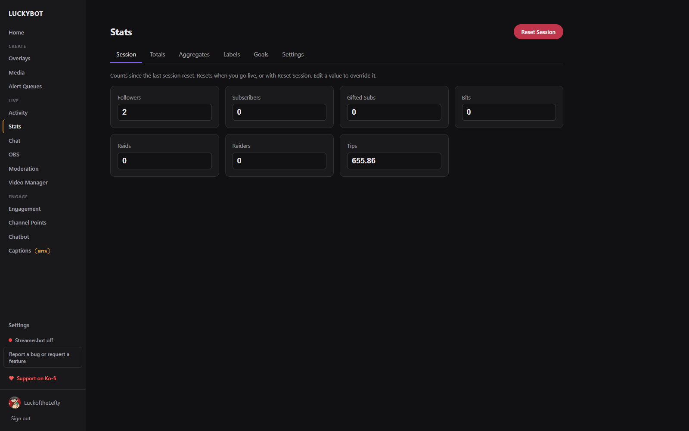
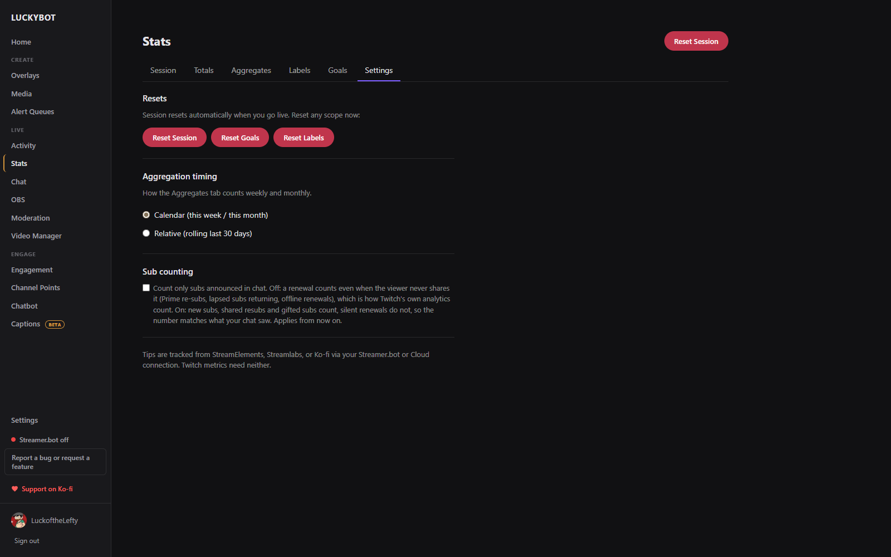
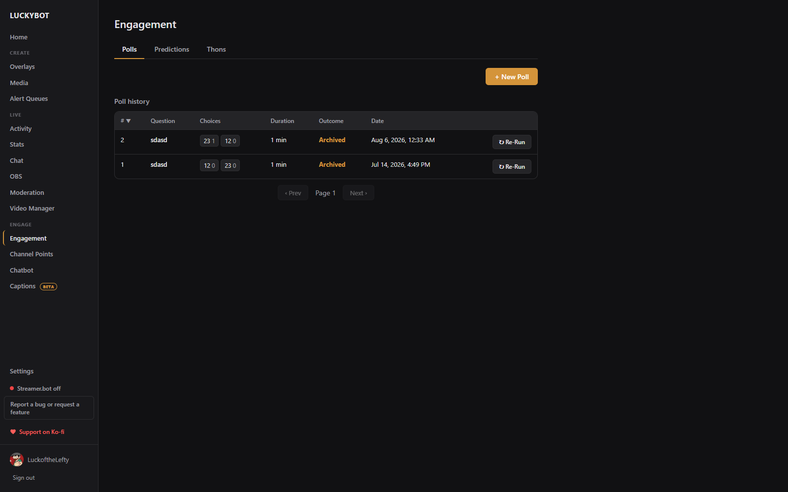
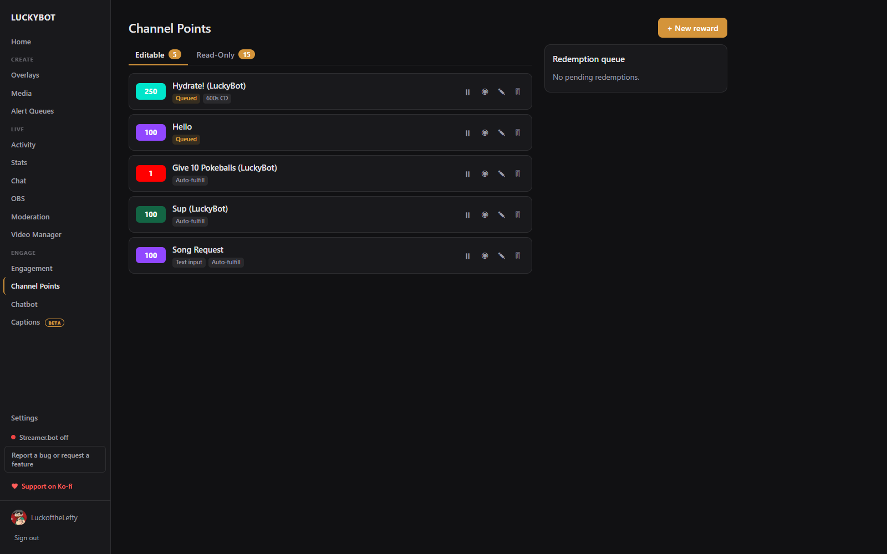
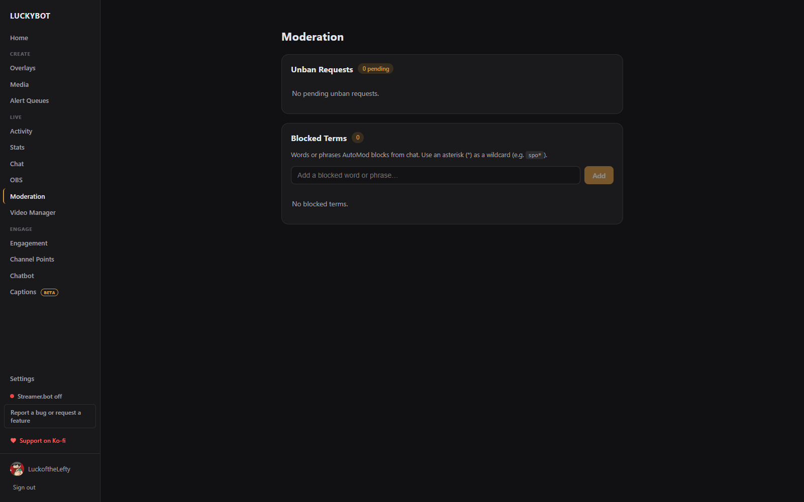
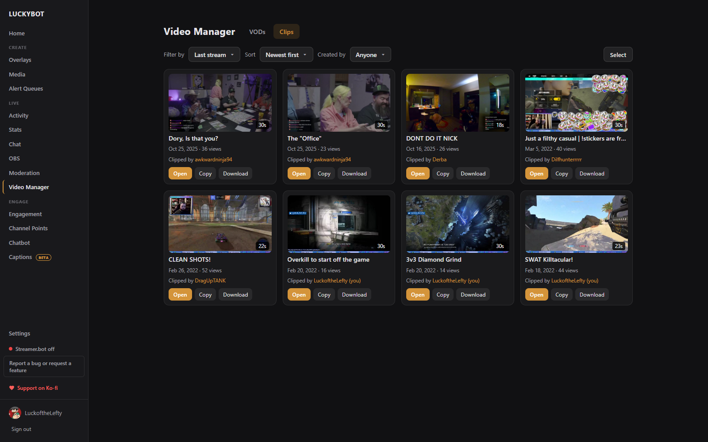
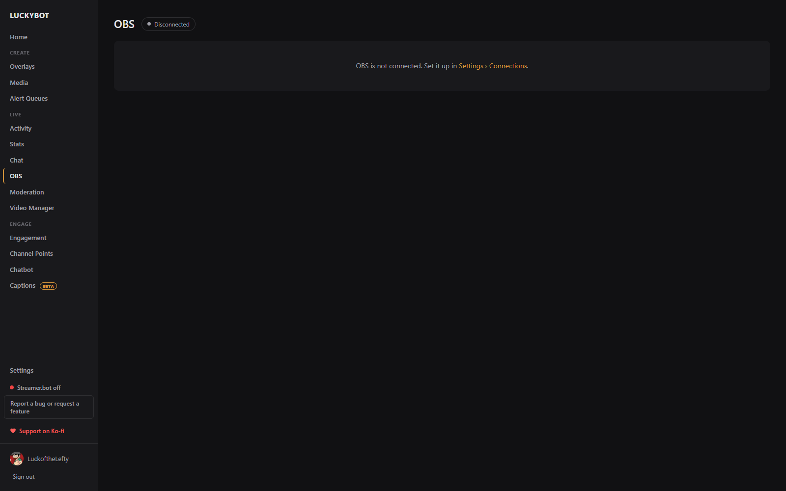
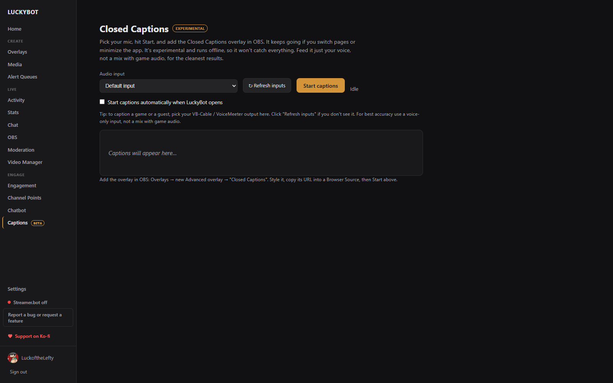

# Stream Tools

Beyond overlays and chat, LuckyBot manages the rest of the stream from dedicated pages in the sidebar.

---

## Home

The landing page shows what is connected, what is running, and what just happened.

<!-- shot: home.png | / | top of Home: the connection strip, Stream info and Running now (crop above Recent Activity so no viewer names show) -->

- **Connection strip**: one chip each for Twitch, OBS, Cloud, and Streamer.bot (plus Home Assistant once it is set up), saying whether each is connected. Click a chip to open Settings.
- **Stream info**: edit your title, category, and up to ten tags. Picking a category saves to Twitch immediately; title and tags save with the Save button. It re-reads Twitch every minute and whenever you come back to the window, so a title or category changed somewhere else (the Twitch dashboard, Streamer.bot, a mod) shows up here. A field you are in the middle of editing is left alone.
- **Getting started**: four steps to your first alert on stream.
- **Running now**: a running or paused thon with the time left, how many timers are on, and how many overlays are on and open in OBS. Each row opens the page that controls it.
- **Recent Activity**: your five most recent events, with a link to the full [Activity](activity-feed.md) page.
- **Your Overlays**: chips for your first four overlays.

A security banner appears here if an overlay page ever runs script outside LuckyBot's policy (see [Overlays](overlays.md#security-notice)).

---

## Stats

Live counts for followers, subscribers, gifted subs, bits, raids, raiders, and tips, across six tabs. Resubs are folded into subscribers.

- **Session**: counts for the current stream. Resets automatically when you go live, or manually with Reset Session. Every value is editable.
- **Totals**: all-time totals. Followers, subscribers, and bits come live from Twitch and are not editable; gifted subs, raids, raiders, and tips can be edited to seed a starting number.
- **Aggregates**: this week and this month (or a rolling 30 days), plus top cheerer, tipper, and gifter leaderboards and an editable all-time gifter board. An **All subs** card adds subscribers and gifted subs together.
- **Labels**: the latest and recent contributor per type (latest follower, latest sub, latest cheerer, tipper, raider). Edit to override what overlays show.
- **Goals**: a target and progress bar for followers, subs, bits, and tips, with a Reset Goals action.
- **Settings**: reset buttons (each one asks "Reset the ... to zero?" before it clears anything); **Aggregation timing** (calendar week and month, or a rolling 30 days); **Hold weekly/monthly resets until the stream ends** for streams that cross a boundary; and **Sub counting**.

**Count only subs announced in chat** changes what a "sub" is. Off (default): a renewal counts even when the viewer never shares it, such as a Prime re-sub, a lapsed sub returning, or an offline renewal, which matches how Twitch's own analytics count. On: new subs, shared resubs, and gifted subs count, silent renewals do not, so your counters match what your chat saw. It applies from the moment you turn it on.

Click any count to edit it, for example to match another tracker. Everything here is available to widgets as live variables. See [Widgets](widgets.md).

---

## Engagement

Polls, predictions, and thons on one page.

- **Polls**: a question with two to five choices and a duration, a live results card while running, End Poll, and a sortable poll history with **Re-Run**.
- **Predictions**: a question with two to ten outcomes and a window, then **Lock**, **Pay out** the winning outcome, or **Cancel & refund**, with a history whose rows open a full result breakdown.
- **Thons**: subathons and point-a-thons. See [Thons](thons.md).

Live poll and prediction bars also appear on the Activity and Chat pages while one is running.

---

## Channel Points

Manage channel point rewards in two tabs:

<!-- shot: channel-points-editable.png | /channel-points | Editable tab, showing the Pause / Disable / Edit / Delete buttons and a "Runs" chip on a reward -->

- **Editable**: rewards created through LuckyBot. Each reward has **Pause** (or **Resume**), **Disable** (or **Enable**), **Edit**, and **Delete** buttons. A reward has a title, cost, color, prompt, optional text input, auto-fulfill, cooldown, and a per-stream limit. Delete asks first in a pop-up that names the reward.
- **Read-Only**: rewards created on Twitch or by another app. Twitch only lets an app manage rewards it created, so use **Copy to LuckyBot** to make an editable duplicate, then disable the original on Twitch.

A reward that sets off a chatbot command shows a **Runs** chip with that command's name. A command set to run on any redemption shows on every reward with "(any reward)".

A **Redemption queue** lists pending redemptions for editable rewards that are not auto-fulfilled, with Approve and Reject (refund) per item and Approve all and Reject all per reward.

---

## Moderation

- **Unban Requests**: review, approve, or deny pending unban requests. Updates live. Each request has an optional reply box; what you type there is sent with your decision.
- **Blocked Terms**: manage the channel's AutoMod blocked term list. An asterisk works as a wildcard. Removing a term asks first, and an **Undo** bar brings back the last one you removed.

Day-to-day moderation (timeouts, bans, chat modes, Shield mode) lives on the [Chat](chat.md) page.

---

## Video Manager

Browse your VODs and clips.

- **VODs**: browse past broadcasts by date range and create clips from them. The clip editor shows the VOD timeline with your stream markers, a draggable 5 to 60 second window, and a preview; give the clip a title and create it.
- **Clips**: filter by range (last stream, 24 hours, 7 or 30 days, all time, custom) and creator, sort by date or views, open a clip with synced chat replay, copy its link, or download it. **Select** enables multi-select for downloading many clips to a folder at once. Deleting and retitling clips happens on Twitch; the page links straight to the Twitch clips manager.

---

## OBS

Connect OBS under **Settings > Connections > OBS Studio** (enable the WebSocket server in OBS first). The OBS page then gives you:

<!-- shot: obs.png | /obs | the page with Studio mode off: transition bar, scene chips, Sources with Shown / Hidden, Audio Mixer -->

- **Go Live / Stop Stream** and **Record / Stop Rec** buttons with a status pill, each with a confirmation, plus **Refresh** to reload scenes, sources, and audio.
- A **transition bar**: pick the **Transition** and its **Duration** in milliseconds (transitions with a fixed length, such as Cut, have no duration).
- A **scene switcher** with the live scene tagged LIVE. Click a scene to switch to it live with the chosen transition.
- A **Sources** panel for the current scene. Each source shows an eye and says **Shown** or **Hidden**; click it to switch.
- An **Audio Mixer** with a volume slider per input and a speaker button to mute and unmute, split into Visible and Hidden tabs.

LuckyBot reloads the scene list by itself when OBS finishes loading a scene collection.

### Studio mode

Turn on the **Studio mode** switch and the page shows **Preview** and **Program** side by side, the same as OBS does. The switch turns studio mode on in OBS itself.

<!-- shot: obs-studio-mode.png | /obs | turn Studio mode on, click a scene so Preview and Program both show (this switches OBS too; turn it back off after) -->

- Click a scene to put it in Preview (tagged PREVIEW), then press **Transition** to send it live. Double-click a scene to send it live straight away.
- **Quick transitions** under the Transition button send Preview live with a different transition once, such as Cut or a short or long Fade, then go back to your usual one.
- While studio mode is on, the Sources panel edits the Preview scene, the same as OBS.
- **Picture updates** sets how often the two pictures refresh: 1, 5, or 10 times a second.

The same connection lets chatbot steps switch scenes, toggle sources and filters, and mute inputs, and lets LuckyBot refresh one of its own browser sources automatically if the page stops responding.

---

## Closed Captions

Live on-screen captions of your microphone, in English. The speech engine runs on your PC, so your voice is never sent online. The page is marked Experimental.

The page has five tabs: **Live captions**, **Overlay**, **Filters**, **Guests**, and **Transcripts**.

To get started:

1. On **Live captions**, pick your microphone and press **Start captions**.
2. On **Overlay**, press **Make the captions overlay**, choose how it looks, and copy its address into an OBS Browser Source.
3. Talk. Your captions show in OBS, and a transcript of the stream is saved.

### Live captions

<!-- shot: captions.png | /captions | Live captions tab: Audio input, Start captions, the level bar, Speech engine and the caption box (open "How to set it up") -->

- **Audio input**: your microphone, or a virtual audio cable such as VB-Cable or VoiceMeeter. **Refresh inputs** looks again if one is missing.
- **Start captions** / **Stop**. While it gets ready the status says what it is doing, such as downloading the speech model. While it runs, a bar shows your microphone level.
- **Speech engine**:
  - **Accurate, with punctuation (Phonon-2)** is the default. It writes punctuation and capitals. The model is about 165 MB and downloads once, the first time you start captions; after that it works offline. On the first start it also times your graphics card, so give it a minute. The page then says what it is running on, for example "Running on your graphics card (..., 69x realtime)".
  - **Basic, for a slower PC** is the earlier engine, with a 40 MB model and no punctuation. If your PC runs the accurate engine too slowly to keep up with speech, the page says so and suggests switching to Basic.
- **Start captions automatically when LuckyBot opens**.
- A preview box shows each line as it is heard.

Captions keep running when you switch pages, minimize LuckyBot, or put other windows in front of it.

Feed it just your voice, without game audio mixed in, for the most accurate captions. To caption a game or another person's audio, pick a virtual audio cable as the input.

The speech model is Phonon-2 by Fermion Research (CC BY 4.0), built on NVIDIA Parakeet TDT.

### Overlay

The captions overlay is set up on this tab. It does not need the New Overlay picker or the code editor.

<!-- shot: captions-overlay.png | /captions | Overlay tab with an overlay made: address and Copy, the Preview with "Show a sample", and the Look settings beside it -->

1. Press **Make the captions overlay**.
2. Under **Add it to OBS**, press **Copy** and paste the address into an OBS Browser Source, set to the width and height the tab shows.
3. Set the look beside the **Preview**. The preview is the overlay itself, scaled down. While captions are stopped it shows a sample line; **Show a sample** and **Sample with a guest** put one there at any time.

The **Look** settings, in groups:

- **Text**: font (93 to pick from, sorted by name, or **Custom (URL below)** for a web font of your own), font size, weight, text color, and uppercase.
- **Style**: outline color and width, background color and opacity.
- **Layout**: vertical position, horizontal position, and text align.
- **Behavior**: max lines, and **Clear after silence (s)**.
- **Guests**: **Names while a guest is on screen**, and **Your name beside your captions** (empty uses your channel name).

A change shows in the preview at once, saves itself a moment later, and reaches OBS by itself.

It is an ordinary overlay underneath: it is in your Overlays list and can be opened in the overlay editor. **Make another one** makes a second captions overlay, for example for another scene, and a menu at the top picks which one you are editing.

If you already had a Closed Captions overlay, the tab finds it and keeps its address. When it was made with an earlier version of LuckyBot, a notice offers **Update the overlay**: your settings are kept, and code you changed by hand in the overlay editor is replaced. Guests' names need the updated overlay.

### Filters

Filters run before anything reaches your overlay or your saved transcripts. Changes save by themselves.

<!-- shot: captions-filters.png | /captions | Filters tab: the Slurs section and Other words with the presets and the five group rows -->

- **Slurs**: always hidden. Choose **Remove the word** (the default) or **Show \*\*\* instead**. **Your names** lists names to protect: speech engines sometimes hear a name as a slur, and when a hidden word sounds like one of these names the captions write the name instead.
- **Other words**: five groups, each set to **Leave in**, **Stars**, or **Remove**:
  - Strong swearing
  - Mild swearing
  - Sexual terms
  - Abuse terms
  - Anatomy and medical words

  Three presets set them all at once: **As spoken** (everything left in, the default), **Clean**, and **Family friendly**. **Never hide these words** keeps the words you list whatever the groups are set to. Slurs are hidden regardless.
- **Clean up**: remove filler words (um, uh, er, hmm), remove repeated words ("I I think" becomes "I think"), and capitalize the start of each line and "I".
- **Word fixes**: when the captions hear the left side, they write the right side. Good for your channel name, friends' names, and game words the engine keeps getting wrong. Up to 100.
- **Always hide**: more words to hide, the same way as slurs.
- **Try it**: type a sentence and see what the filters make of it.

The filters also apply to what guests say.

Word lists adapted from the List of Dirty, Naughty, Obscene, and Otherwise Bad Words by Shutterstock (CC BY 4.0).

### Guests

Invite up to 3 people to caption their own microphone onto your captions, for example co-streamers or a podcast guest.

<!-- shot: captions-guests.png | /captions | Guests tab with an invite link made (mask the link) and "Before you invite someone" -->

- Press **Make an invite link** and send the link with **Copy**.
- A guest opens the link in Chrome or Edge on a computer. They need no account and nothing to install. The speech engine runs on their computer (the first start downloads the same 165 MB model there), and only the caption text is sent.
- **On your captions now** lists who joined, with **Talking**, **Connected**, or **Muted** beside each name, and **Mute** and **Remove** buttons. Remove takes someone off; to keep them out, make a new link.
- **Make a new link** or **Turn invites off** removes everyone who joined with the current link.
- While a guest's captions are on screen, each speaker gets a row with their name. On your own, your captions look the way they always do.
- Guest lines go into your transcript under the guest's name.

Inviting guests needs a paid LuckyBot Cloud account connected in Settings, because guests reach you through LuckyBot Cloud and need the internet. Your own captions stay free and work offline. To show guests on stream, update your captions overlay on the Overlay tab if it asks.

### Transcripts

Captions are saved as one transcript per stream. Transcripts stay on your PC.

<!-- shot: captions-transcripts.png | /captions | Transcripts tab list (open one only if it shows no viewer names) -->

- **Save a transcript while captions are running** turns saving on or off. A transcript starts with your first finished line.
- Each transcript has subs, raids, cheers, tips, redeems, game and title changes, stream markers, clips, and chat activity on the same timeline as your words. **Show stream events** hides or shows them.
- **Search every transcript** finds a word or phrase across all of them.
- The name follows your stream title. Rename it to keep your own; clear the name to follow the stream title again.
- **Chat activity** charts chat messages over the stream. Click a bar to jump there.
- **Chat spikes** lists moments when chat ran well above its usual pace, which are good places to look for clips.
- **Chapters** are built from game and title changes and stream markers. **Copy for YouTube** copies them for a VOD description.
- **Export**: text with timestamps, text only, subtitles (SRT) for the VOD, subtitles (WebVTT), YouTube chapters, or everything (JSON).
- **Finish transcript** ends the one being recorded; **Delete** removes a transcript.

### Captions in a browser

[cloud.luckybot.app/captions](https://cloud.luckybot.app/captions) runs the same speech engine in your browser, without the app. It is free with a LuckyBot Cloud account. It has the same filter groups and fonts, and it gives you its own caption overlay address for OBS.
