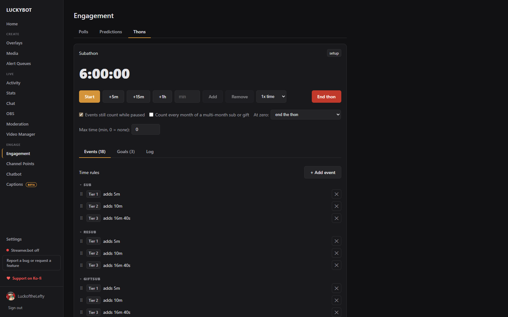
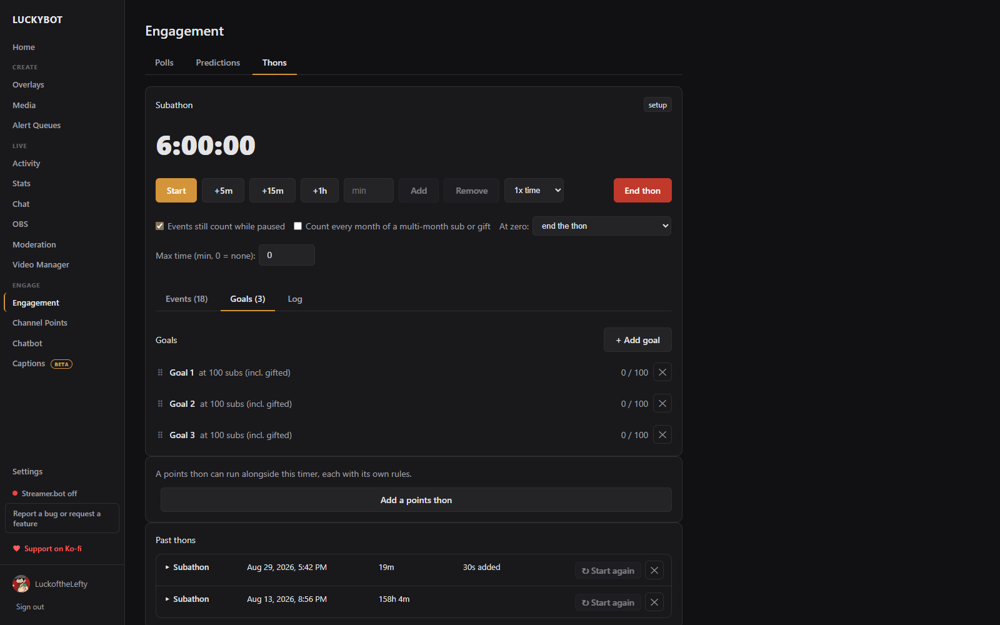

# Thons

A thon is a countdown your viewers extend (a subathon), or a points goal they fill: subs, gift bombs, bits, Power-Ups, tips, YouTube Super Chats and Gifts, raids, follows, or any other event add time or earn points by rules you set, with milestone goals along the way.

It all runs on the server, so OBS reloads and crashes never lose anything and pausing is exact. Two overlay templates put it on stream: **Subathon Timer** and **Thon Goals (Milestones)**, both under the Advanced tab of the New Overlay browser.

Thons live under **Engagement > Thons**.

---

## Setting one up

Click **Set up a thon**. The wizard asks a few plain-English questions.

1. Pick the kind: **Countdown timer** (a clock viewers extend) or **Points goal** (events earn points toward a target; goals along the way are milestones, and goals past the target are stretch goals). Name it and set the starting time or the points target.
2. Either **Use the basic template** or **Start from scratch**. The template offers one line per source, each with a checkbox:
   - **Subs / ReSubs / Gift Subs**: seconds (or points) per Tier 1, 2, and 3. Gift bombs follow the tier values per gifted sub inside the bomb, without double granting.
   - **Cheers**: an amount per 100 bits.
   - **Tips**: an amount per dollar, from Streamlabs, StreamElements, Ko-fi, and Fourthwall.
   - **Follows** and **Raids** (with a minimum viewer count for raids).
   - **Per-viewer bonus** on raids: an amount per viewer, capped.
   - **Count every month of a multi-month sub or gift**: off by default, so buying or gifting six months at once counts as one sub.
3. **Create the thon**. Everything lands as editable rules on the thon, and the thon starts in setup until you press **Start**.

One countdown timer and one points thon can run at the same time, each with its own rules.

---

## Running it

The active thon card is the remote control:

- **Start**, **Pause**, and **Resume**. Pausing is exact; the clock stops to the second.
- Quick adds: **+5m**, **+15m**, **+1h** (or +10, +50, +100 points), and a box to **Add** or **Remove** any amount.
- The multiplier select (**1x**, 1.5x, 2x, 3x) applies to every rule grant while set: a manual happy hour. A green chip shows an active boost and when it ends.
- **Events still count while paused**: on by default.
- **At zero**: end the thon, or stay at 0:00 so late subs revive it.
- **Max time**: a ceiling in minutes, 0 for none.
- **Count every month of a multi-month sub or gift**: the same choice the wizard offers, changeable while the thon runs.
- In a points thon, **Points target** (0 for open-ended) and **When the goal is reached**: keep counting toward stretch goals, or end the thon.
- **End thon**: click it, then **Really end it?** to confirm.

Totals chips show subs, gift subs, bits, tips, raid viewers, follows, and how much time viewers added in total.

---

## Events, Goals, and Log

### Events

The rules, grouped under a heading per event (click a heading to fold it). Each rule is a card that reads like the rest of LuckyBot: any condition it has (a tier, an amount range) under **Only if**, and what it does under **Do**, for example "adds 1 point per 100 bits" or "activates 2x for 30 min". Click a rule to edit it in a pop-up. **+ Add event** adds a rule; drag to reorder; **Save rules** commits edits. Removing a rule asks first.

<!-- shot: engagement-thons-rules.png | /engagement | Thons tab with a thon open, Events tab: rule cards grouped by event, one rule's Edit rule pop-up open with More options showing -->

Each rule opens with one number:

- **Bits, Power-Ups, tips, Super Chats, YouTube Gifts, and gift bombs** pay by the amount: "60 seconds per 100 bits", a point per dollar, an amount per gifted sub.
- **Everything else** pays a set amount per event: "3 points per event".

Every event counts in its own unit: Power-Ups in bits, tips and Super Chats in dollars, YouTube Gifts in Jewels, resubs in months, raids in viewers, watch streaks in streams, and channel point rewards in channel points. Follows, subs, and gift subs have no amount.

Where an event has an amount, **More options** holds the rest, one setting per line:

- **Amount range**: only count events from this amount to that one.
- **Bonus** (or **By amount**): the other half of the formula, a flat amount on top of a per-amount rule, or a per-amount bonus on top of a per-event rule.
- **Below** a full unit: whether 69 bits on a per-100 rule **earns nothing** or **earns a share**.
- **Limit**: the most one event can earn from its amount.

A rule that already uses one of these opens with More options showing. Pick **activates** in place of **adds** to turn on a timed multiplier ("2x time for 30 minutes").

New rules start with these numbers: cheers and Power-Ups at a point (or 60 seconds) per 100 bits, tips and Super Chats at a point (or 60 seconds) per dollar, gift bombs at the same rate per gifted sub as a single sub, and raids in a countdown at 120 seconds plus a second per viewer. Change any of them.

**Test an event** runs any event through the same pipeline as a real one. Pick the event and its amount, tier, or months. **Preview** reports what would happen without changing anything; **Fire for real** adds real time and shows on the overlay, and can be undone from the log.

### Goals

Milestones on the thon's running totals, or on single big moments (gifted subs at once, bits at once, raiders at once, hype train level). Hitting one can add time, turn on a timed multiplier, or both: "500 subs reached, 2x time for an hour." Each goal has a label that shows on the goals overlay and in the log. **+ Add goal** asks a few plain questions and adds one; click a goal to edit it in a pop-up, and **Save goals** commits edits. Drag to set the overlay's display order. Removing a goal asks first.

### Log

Every grant, with the event, the viewer, the amount, and the time it added. Anything can be undone from here while the thon runs, so the math is always checkable.

---

## Past thons

Finished thons stay in the table with their totals, goals hit, and top time contributors. **Start again** opens the wizard with that thon's rules and goals carried over, so a recurring subathon takes seconds to set up. Deleting a past thon's record asks first and takes its totals and history with it.

---

## On stream

- **Subathon Timer** overlay: the clock, with fly-ups for added time and who added it, a pulse on adds, a multiplier badge, a low-time color, and a paused label. Field settings cover the title, clock format, colors, font, and size.
- **Thon Goals (Milestones)** overlay: upcoming and completed goals with a progress bar on the current one, an unlock sound, and a choice of which thon and which metrics to show.

Both overlays follow the server, so refreshing the browser source shows the correct time and progress immediately. Thon events also feed [chatbot event triggers](chat-bot.md), so a command can announce each grant in chat.

Home's **Running now** shows a running thon's time left and any active multiplier, and the [Activity feed](activity-feed.md) shows the time or points each event added as a chip under that event.
